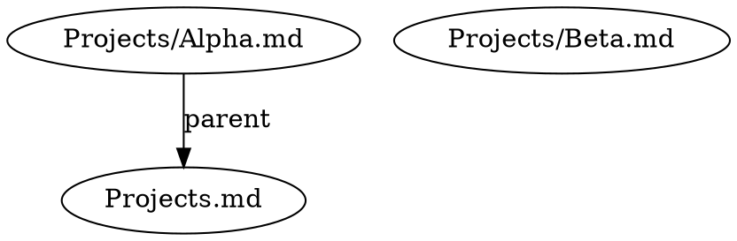

# Graph CLI specification

Status: partial CLI implementation. `graph neighbors` is supported as a thin
adapter over the shared API. Traversal and graph export remain proposals
because the shared API does not provide those operations. This does not claim
Breadcrumbs compatibility.

## Goals and boundaries

- Keep the shared JavaScript API as the source of graph semantics; the CLI
  must not implement independent graph-query behavior.
- Preserve directed, typed relationships and vault-relative POSIX paths.
- Use explicitly configured frontmatter edge fields only. Do not infer edges,
  execute vault-supplied JavaScript, or apply Breadcrumbs transitive rules.
- Keep operations local and read-only. Emit machine-readable data to stdout
  and diagnostics to stderr.
- Bound query and export work. Never present a partial graph as a complete
  export.

The current API supports direct neighbors for configured frontmatter fields.
Traversal and whole-graph export require shared-API support before they can be
implemented in the CLI.

## Command shape

```text
obsidian-query-tools --vault <directory> graph neighbors <path>
  --edge-field <field>... [--direction <incoming|outgoing>] [--edge-type <type>...]
  [--limit <count>]

obsidian-query-tools --vault <directory> graph traverse <path>
  --edge-field <field>... [--direction <incoming|outgoing>] [--edge-type <type>...]
  --max-depth <count> [--limit <count>]

obsidian-query-tools --vault <directory> graph export
  --edge-field <field>... --format <json|graphml|dot>
```

`--edge-field` is specified after `graph <subcommand>` and may be repeated.
The option chooses which frontmatter fields are indexed as typed edges; it
does not redefine edge values or query semantics. `--edge-type` filters the
resulting edge types and is separate from `--edge-field`. The vault is
explicitly selected with `--vault`. All paths in arguments and output are
vault-relative; absolute paths and paths escaping the vault are rejected.

`neighbors` returns direct matches only. `direction` selects edges entering
or leaving the requested note; if omitted, the API's documented default
applies. `traverse` follows matching edges up to the required positive
`--max-depth`. It returns each reached note once, with its minimum hop depth,
and must terminate on cycles. Ordering is deterministic by depth and then
vault-relative path unless the shared API specifies a stable equivalent.

`export` includes every indexed Markdown note as a node, including isolated
notes, and every indexed edge matching the requested fields. It preserves
edge direction and type. JSON is intended for scripting, GraphML for graph
analysis applications, and DOT for Graphviz visualization.

## Output

Successful commands write exactly one result to stdout. Query results use a
JSON envelope with the index generation, data, diagnostics, and a `truncated`
boolean. Errors produce no successful result, write a concise structured
diagnostic to stderr, and exit nonzero. Vault contents and query results must
not be logged to stderr.

Example direct-neighbor command and output:

```sh
obsidian-query-tools --vault ./vault graph neighbors Projects/Alpha.md \
  --edge-field parent --direction outgoing --edge-type parent
```

```json
{
	"generation": 1,
	"data": [
		{
			"source": "Projects/Alpha.md",
			"target": "Projects.md",
			"type": "parent"
		}
	],
	"diagnostics": [],
	"truncated": false
}
```

Example JSON export command:

```sh
obsidian-query-tools --vault ./vault graph export \
  --edge-field parent --format json > graph.json
```

The JSON `data` contains deterministically ordered `nodes` and `edges`.
Nodes are relative Markdown paths; edges have `source`, `target`, and `type`.
Isolated notes are included:

```json
{
	"generation": 1,
	"data": {
		"nodes": ["Projects.md", "Projects/Alpha.md", "Projects/Beta.md"],
		"edges": [
			{
				"source": "Projects/Alpha.md",
				"target": "Projects.md",
				"type": "parent"
			}
		]
	},
	"diagnostics": [],
	"truncated": false
}
```

The same graph can be written as GraphML or DOT:

```sh
obsidian-query-tools --vault ./vault graph export \
  --edge-field parent --format graphml > graph.graphml

obsidian-query-tools --vault ./vault graph export \
  --edge-field parent --format dot > graph.dot
```

```xml
<?xml version="1.0" encoding="UTF-8"?>
<graphml xmlns="http://graphml.graphdrawing.org/xmlns">
  <key id="path" for="node" attr.name="path" attr.type="string"/>
  <key id="type" for="edge" attr.name="type" attr.type="string"/>
  <graph id="vault" edgedefault="directed">
    <node id="n0"><data key="path">Projects.md</data></node>
    <node id="n1"><data key="path">Projects/Alpha.md</data></node>
    <node id="n2"><data key="path">Projects/Beta.md</data></node>
    <edge id="e0" source="n1" target="n0">
      <data key="type">parent</data>
    </edge>
  </graph>
</graphml>
```

GraphML node identifiers are stable generated IDs; each node's `path` data
retains its vault-relative identity.



Native GraphML and DOT output must correctly escape identifiers and values.
Their stdout must contain only the selected format, without a JSON wrapper.
Diagnostics remain on stderr.

## Limits, errors, and compatibility

The shared API must enforce the configured node, edge, depth, and result
limits. Query results may be explicitly marked truncated if the shared API
supports that contract. A graph export must be complete: if configured
resource limits prevent emitting the whole graph, fail with an actionable
error instead of silently omitting nodes or edges. Do not promise atomic
filesystem snapshots beyond the shared API's documented indexing guarantees.

Invalid options, unsupported formats, invalid paths, build errors, and limit
exhaustion fail explicitly with a nonzero exit status. Stdout must not contain
progress or error messages that would corrupt JSON, GraphML, or DOT.

The proposal describes a project-defined typed-edge graph, not Breadcrumbs
parity. Any future compatibility claim requires pinned upstream revisions
and representative fixture evidence, as described in the project
requirements and design.

## Implementation prerequisites

1. Define shared API result types and semantics for bounded traversal and
   complete graph export, including stable ordering, generation, and limits.
2. Add API tests for direction, type filtering, cycles, isolated notes,
   limits, serialization escaping, and unchanged vault contents.
3. Implement `graph` as a thin CLI adapter over those API operations and test
   stdout/stderr, exit status, and output format against representative
   fixtures.
